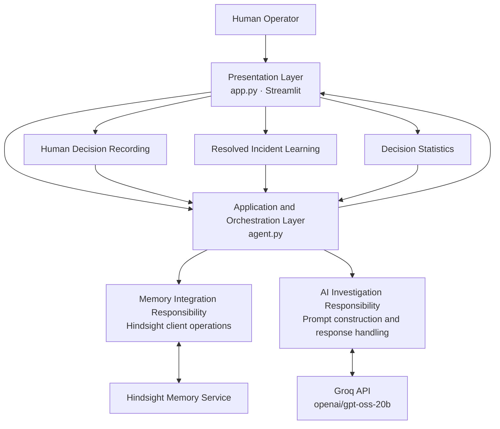

# RecallOps

**AI-Powered Incident Investigation with Persistent Memory**

RecallOps is an AI-assisted incident investigation application built with Streamlit, Groq, and Hindsight. It retrieves relevant historical incident memories, uses them to support an AI-generated investigation, records human decisions, and stores resolved incidents for future reference.

## Table of Contents

1. Overview
2. Features
3. Architecture
4. Technology Stack
5. Project Structure
6. Prerequisites
7. Installation and Setup
8. Environment Configuration
9. Running the Application
10. Incident Investigation Workflow
11. Memory and Human Decision Tracking
12. Security Considerations
13. Current Limitations

## 1. Overview

Incident response often requires engineers to investigate recurring problems across services, databases, and infrastructure. Relevant context may be scattered across previous incidents, making diagnosis slower and less consistent.

RecallOps addresses this challenge by combining historical incident retrieval with AI-assisted investigation and human oversight.

The application supports the investigation process by:

- Retrieving relevant historical incident memories.
- Generating an investigation grounded in the available incident context.
- Presenting recommendations and their supporting reasoning.
- Recording whether a human accepts, overrides, or escalates a recommendation.
- Storing resolved incident information for use in future investigations.

RecallOps is designed to assist human operators. Its generated recommendations should be reviewed before operational changes are made.

## 2. Features

### Historical Incident Retrieval

Uses Hindsight to retrieve previously stored memories relevant to a new incident.

### AI-Assisted Investigation

Uses a Groq-hosted language model to generate a structured investigation based on the current incident and retrieved historical context.

### Human-in-the-Loop Decisions

Records human decisions associated with an investigation, including accepted, overridden, and escalated recommendations.

### Persistent Incident Learning

Allows resolved incidents to be stored with their root cause, resolution, and outcome so that this information can inform future investigations.

### Decision Tracking

Retrieves recorded human decisions and calculates accepted, overridden, and escalated counts for the current incident.

### Investigation Context

Displays the historical memories retrieved for an investigation, helping operators understand the context used by the AI.

## 3. Architecture

RecallOps follows a layered logical architecture. The layers describe separate responsibilities, while the current implementation keeps most application orchestration and Hindsight client operations in `agent.py`.



### Architecture Layers

**Presentation Layer: `app.py`**

Provides the Streamlit interface for submitting incidents, viewing investigation results and retrieved memories, recording human decisions, and saving resolved incident information.

**Application and Orchestration Layer: `agent.py`**

Coordinates the main application workflow. It prepares incident queries, retrieves historical context, calls the language model, records decisions, stores resolution information, and retrieves decision statistics.

**Memory Integration Responsibility: Hindsight client operations**

Uses the Hindsight client to retrieve and retain information. These operations currently reside in `agent.py`; a separate memory integration module has not been implemented.

**AI Investigation Responsibility: Prompt construction and response handling**

Builds the investigation prompt using the incident and retrieved memories, calls the Groq API, and returns the generated answer alongside the recalled memories and investigation identifier. This responsibility currently resides in `agent.py`.

**External Services**

- **Hindsight:** Stores and retrieves persistent incident memories.
- **Groq:** Provides access to the language model used for investigation generation.

The architecture separates these responsibilities conceptually without claiming that every layer is already implemented as an independent module.

## 4. Technology Stack

| Technology | Purpose |
|---|---|
| Python | Application logic |
| Streamlit | User interface |
| Hindsight | Persistent memory retrieval and retention |
| Groq API | AI-assisted investigation |
| `python-dotenv` | Environment variable loading |
| `concurrent.futures` | Running Hindsight operations through a thread pool |

The application uses the Groq model identifier `openai/gpt-oss-20b`.

## 5. Project Structure

```text
RecallOps/
├── app.py
├── agent.py
├── hindsight.py
├── requirements.txt
├── .env
└── README.md
```

- `app.py`: Streamlit application and user interface.
- `agent.py`: Incident investigation, memory retrieval, decision recording, resolution learning, and decision statistics.
- `hindsight.py`: Standalone script for testing retrieval of similar historical incidents.
- `requirements.txt`: Python dependency specifications.
- `.env`: Local configuration for external service credentials.
- `README.md`: Project documentation.

The `.env` file should remain local and must not be committed to version control.

## 6. Prerequisites

Before running RecallOps, ensure you have:

- Python installed.
- Access to a configured Hindsight service.
- A valid Hindsight API key and service URL, if required by your deployment.
- A valid Groq API key.
- Git, if cloning the project from a repository.

The Hindsight service must be reachable from the machine running the application.

## 7. Installation and Setup

### Step 1: Clone the repository

```bash
git clone <your-repository-url>
cd RecallOps
```

Replace the placeholder with your repository URL.

### Step 2: Create a virtual environment

On macOS or Linux:

```bash
python3 -m venv .venv
source .venv/bin/activate
```

On Windows:

```powershell
python -m venv .venv
.venv\Scripts\activate
```

### Step 3: Install dependencies

```bash
python -m pip install --upgrade pip
pip install -r requirements.txt
```

## 8. Environment Configuration

Create a `.env` file in the project root:

```dotenv
HINDSIGHT_BASE_URL=your_hindsight_service_url
HINDSIGHT_API_KEY=your_hindsight_api_key
GROQ_API_KEY=your_groq_api_key
```

Replace each placeholder with the corresponding value from your service configuration.

The application loads these variables using `python-dotenv`.

**Security requirements:**

- Do not commit `.env` to Git.
- Do not place API keys directly in source code.
- Do not expose credentials in screenshots, logs, or public repositories.
- Rotate any credentials that have been accidentally exposed.

## 9. Running the Application

Start the Streamlit application from the project root:

```bash
streamlit run app.py
```

Streamlit will display a local URL in the terminal. Open that URL in your browser.

To test historical memory retrieval independently, run:

```bash
python hindsight.py
```

The standalone script submits a sample payment API incident to Hindsight and prints the retrieved memories. It is a retrieval test, not a separate backend service or a required step for launching the main application.

## 10. Incident Investigation Workflow

A typical investigation follows this sequence:

1. **Submit an incident.** The operator provides a description of the issue.
2. **Prepare the query.** RecallOps normalizes the incident text and limits the recall query length.
3. **Retrieve historical context.** The application queries Hindsight using the `recallops` memory bank and retrieves up to ten results.
4. **Construct the investigation prompt.** The current incident and recalled memories are included in the prompt sent to the language model.
5. **Generate the investigation.** The Groq API generates an answer intended to identify a likely root cause, indicate confidence, recommend actions, explain the reasoning, and identify relevant historical incidents.
6. **Present the result.** The application returns the investigation answer, recalled memories, and investigation identifier to the interface.
7. **Record the human decision.** The operator can record whether the recommendation was accepted, overridden, or escalated.
8. **Save the resolution.** After resolving the incident, the operator can store the root cause, resolution, and outcome for future retrieval.

The generated analysis depends on the available incident information and retrieved memories. A confidence label produced by the model is not a calibrated statistical probability.

## 11. Memory and Human Decision Tracking

### Memory Bank

The application uses the Hindsight bank identifier:

```python
BANK_ID = "recallops"
```

Historical incident memories are retrieved from this bank and included in the investigation context when available.

### Human Decision Records

Human decisions are retained with information including:

- Incident identifier derived from the incident text.
- Investigation identifier.
- Incident description.
- Recommendation.
- Human decision.
- Decision timestamp.

The implementation uses an investigation-specific document identifier when retaining decision records, allowing an updated decision for that investigation to replace its existing record.

### Resolved Incident Learning

The resolution workflow stores the incident description alongside its root cause, resolution, and outcome. This information can be retrieved as historical context in later investigations.

### Decision Statistics

RecallOps retrieves stored memories and filters human decision records for the current incident. It counts the accepted, overridden, and escalated decisions by investigation.

The current implementation retrieves at most 1,000 memory items for this calculation. Older records may therefore be excluded if the memory bank contains more items than the query limit.

## 12. Security Considerations

RecallOps interacts with external AI and memory services. Incident descriptions and retained memories may contain sensitive operational information.

Before using the application with production data:

- Remove secrets and unnecessary personal information from incident descriptions.
- Configure access controls for the application and external services.
- Store credentials in environment variables or a managed secrets system.
- Review data retention and access policies for the configured services.
- Validate AI-generated recommendations before executing operational actions.
- Avoid treating recalled historical incidents as proof that the current incident has the same root cause.

The application assists investigation and decision-making; it should not replace human review or established incident response procedures.

## 13. Current Limitations

- Investigation quality depends on the incident description, retrieved memories, and language model output.
- The application retrieves up to ten memories for an investigation.
- Decision statistics are based on a retrieval limited to 1,000 memory items.
- The standalone `hindsight.py` script is a simple retrieval test, not a separate service.
- The memory integration and AI investigation responsibilities are logical layers within `agent.py`, rather than independent modules.
- External service availability, API limits, credentials, and configuration can affect execution.
- The README documents the implementation and intended workflow; it does not imply that every deployment configuration or external API call has been independently tested.

## Future Improvements

Potential improvements include:

- Extracting Hindsight operations into a dedicated memory integration module.
- Separating prompt construction and Groq calls into a dedicated investigation module.
- Adding automated tests for incident retrieval, decision recording, and resolution learning.
- Improving pagination or querying for decision statistics.
- Adding structured validation for AI-generated investigation output.
- Introducing observability, structured logging, and improved error handling.
- Adding authentication and authorization for multi-user deployments.

---

**RecallOps** combines historical incident context, AI-assisted investigation, and human decision tracking to support more consistent incident response.
